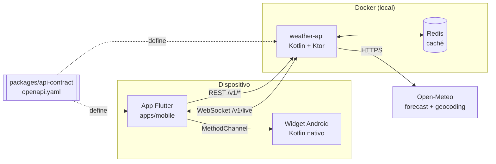
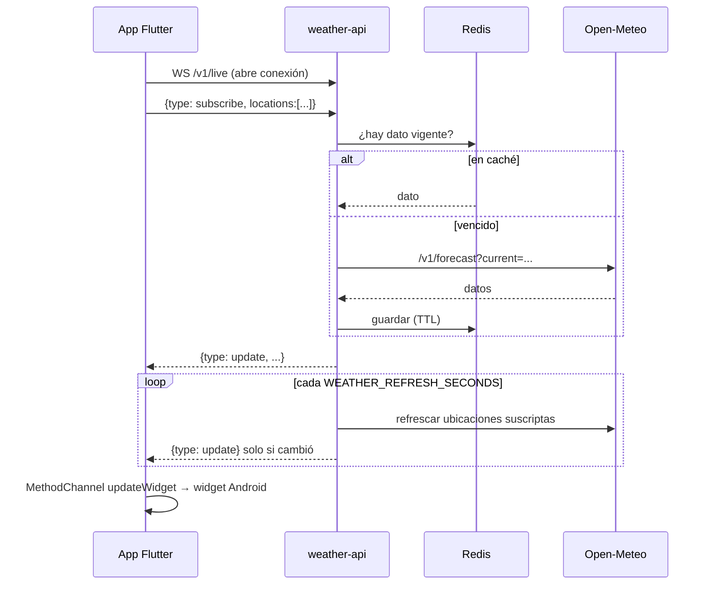

# Arquitectura

## Vista general

## Piezas

| Pieza | Responsabilidad | No hace |
|---|---|---|
| App Flutter | UI, estado, favoritos locales, suscripción WebSocket | No llama a Open-Meteo |
| Widget Kotlin | Muestra la ciudad principal en la pantalla de inicio | No llama a la red |
| weather-api | Traduce Open-Meteo al contrato, cachea, empuja actualizaciones | No guarda usuarios (por ahora) |
| Redis | Caché con TTL por ubicación | No es base de datos permanente |
| api-contract | Define endpoints y modelos | No contiene código |

## Flujo "tiempo real"

"Tiempo real" acá significa **push del servidor** apenas hay dato nuevo. Open-Meteo recalcula el clima actual cada ~15 minutos, así que refrescar más seguido no trae datos distintos.

## Por qué un monorepo

Un solo repo con app, backend y contrato permite que un cambio de endpoint viaje en un solo PR y que Cursor vea las dos puntas a la vez. Ver `adr/0001-monorepo.md`.

## Decisiones (ADR)

| ADR | Tema |
|---|---|
| [0001](adr/0001-monorepo.md) | Monorepo sin herramienta de orquestación |
| [0002](adr/0002-open-meteo.md) | Open-Meteo como fuente de datos |
| [0003](adr/0003-kotlin-backend-y-nativo.md) | Kotlin en backend y en Android nativo |
| [0004](adr/0004-estado-flutter.md) | Gestión de estado en Flutter |
