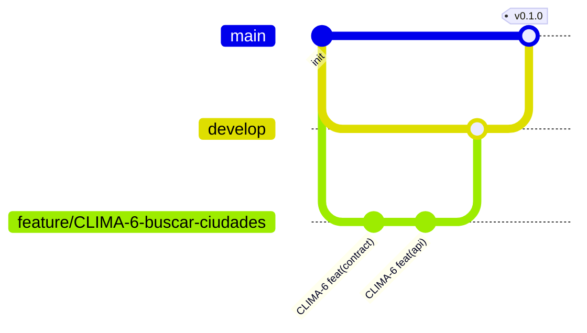

# Flujo de trabajo: Jira + GitHub + Cursor

## Ramas



| Rama | Uso | Protección sugerida |
|---|---|---|
| `main` | Versiones estables | PR obligatorio, CI en verde |
| `develop` | Integración | PR obligatorio, CI en verde |
| `feature/CLIMA-n-slug` | Historias | — |
| `fix/CLIMA-n-slug` | Correcciones | — |
| `chore/CLIMA-n-slug` | Infra, CI, docs | — |

## Commits

```
CLIMA-<n> <tipo>(<alcance>): <descripción>
```

Ejemplos:

```
CLIMA-6 feat(contract): agregar /v1/cities/search
CLIMA-6 feat(api): implementar búsqueda con Open-Meteo geocoding
CLIMA-11 feat(android): widget de pantalla de inicio
```

Incluir la clave `CLIMA-n` hace que Jira vincule el commit, la rama y el PR al ticket (requiere la integración de GitHub con Jira, ver abajo).

## Ciclo de una historia

| Paso | Dónde | Cómo |
|---|---|---|
| 1. Tomar ticket | Jira | Mover a *En curso* |
| 2. Planificar | Cursor | `/empezar-ticket CLIMA-n` (modo Plan) |
| 3. Implementar | Cursor | Modo Agent, skill correspondiente |
| 4. Verificar | Cursor | Subagente `tester` |
| 5. Revisar | Cursor | `/preparar-pr` (subagente `revisor`) |
| 6. PR | GitHub | Plantilla completa, CI en verde |
| 7. Merge | GitHub | Squash a `develop` |
| 8. Cerrar | Jira | Mover a *Hecho* |

## Configurar Jira (una vez)

1. Crear un proyecto de software tipo **Scrum** con clave `CLIMA`.
2. Estados: *Por hacer → En curso → En revisión → Hecho*.
3. Cargar las épicas e historias de `04-backlog-inicial.md`.
4. Instalar **GitHub for Jira** desde el Marketplace de Atlassian y conectar el repositorio. Así los commits, ramas y PR con `CLIMA-n` aparecen en el ticket.

## Configurar GitHub (una vez)

1. Crear el repositorio `clima-monorepo` y subir esta estructura:
   ```bash
   git init -b main
   git add .
   git commit -m "CLIMA-1 chore(infra): estructura base del monorepo"
   git remote add origin https://github.com/<usuario>/clima-monorepo.git
   git push -u origin main
   git switch -c develop && git push -u origin develop
   ```
2. Settings → Branches: proteger `main` y `develop` (PR obligatorio + checks).
3. Los workflows de `.github/workflows/` se activan solos por carpeta y se saltean mientras el proyecto de esa carpeta no exista.

## CI

| Workflow | Se activa con cambios en | Qué hace |
|---|---|---|
| `mobile-ci` | `apps/mobile/**`, contrato | analyze, test, build APK debug |
| `api-ci` | `services/weather-api/**`, contrato, compose | test Gradle, build de imagen Docker |
| `contract-ci` | `packages/api-contract/**` | lint del OpenAPI con Redocly |
